<h1 align="center">Seabed Sentinel</h1>

<p align="center"><b>Physics-grounded synthetic aperture sonar (SAS) simulation, image formation and AI automatic target recognition (ATR) for seabed survey and mine countermeasures</b></p>

<p align="center">
<a href="https://github.com/shahriarrashid54/sub_sea_robotics/actions"></a>


</p>

<p align="center">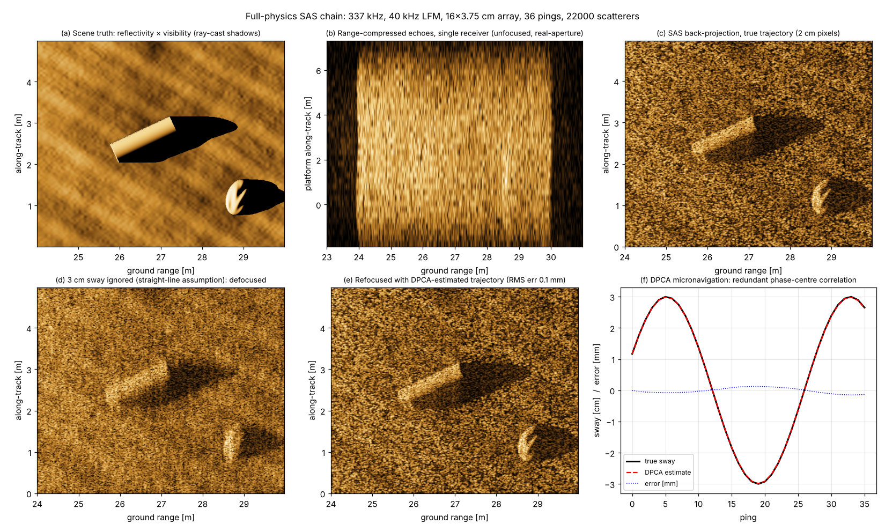</p>

Seabed Sentinel is an end-to-end research stack that goes from **the acoustics of a
multi-element synthetic aperture sonar** all the way to **an AUV deciding where to look
next**:

```
LFM chirp ─► multi-element echoes ─► matched filter ─► back-projection ─► DPCA micronavigation
                                                                                │
   seabed + mine-like objects ─► ray-cast shadows ─► coherent speckle ─► labelled SAS tiles
                                                                                │
                MAE pre-training ─► shadow-aware anchor-free detector ─► PD / FA-per-km², uncertainty, Grad-CAM
                                                                                │
                      ONNX ─► streaming real-time ATR ─► geo-referenced contacts ─► multi-aspect fusion ─► re-look planning
```

Everything runs on a laptop CPU, is reproducible with one command, and is unit-tested
against the physics it claims to implement (shadow geometry, SAS resolution, the speed
constraint, DPCA sway recovery).

> **Why this exists.** I built this to show, concretely, how I would approach ATR for a
> commercial SAS such as Kraken Robotics' AquaPix / KATFISH systems: start from the
> sensor physics, generate labelled data where none is public, measure what operators
> care about (PD vs. false alarms per km², not just mAP), and close the loop with
> autonomy. See [`docs/KRAKEN_RELEVANCE.md`](docs/KRAKEN_RELEVANCE.md).

---

## Highlights

| | |
|---|---|
| **Full-physics SAS chain** | 337 kHz / 40 kHz LFM, 16 × 3.75 cm receiver array (public MINSAS-class figures). Pulse-level echo synthesis with element directivity, matched filtering, time-domain back-projection. Measured point response **<!--R:psf_along_20-->1.91<!--/R--> cm along-track at 20 m and <!--R:psf_along_45-->1.95<!--/R--> cm at 45 m** against the theoretical *d/2* = 1.875 cm: range-independent resolution, the defining property of SAS. |
| **DPCA micronavigation** | Redundant phase-centre cross-correlation recovers a 3 cm platform sway with **<!--R:dpca_rms-->0.09<!--/R--> mm RMS error** and refocuses the image (contrast <!--R:contrast_nom-->1.65<!--/R--> → <!--R:contrast_dpca-->2.10<!--/R-->, truth <!--R:contrast_true-->2.12<!--/R-->). |
| **Physics-based data generator** | Lambert + specular backscatter from the local grazing angle, *exact* ray-cast acoustic shadows, coherent speckle convolved with the system PSF, range-dependent SNR / TVG residuals, ping drop-outs, striping and motion smear. 3 300 labelled 288² tiles (3 cm pixels) in ~10 min on 4 cores, with highlight **and** shadow boxes, semantic masks, aspect, range, grazing and burial. |
| **Shadow-aware ATR** | 2.1 M-parameter anchor-free (CenterNet-style) detector with an auxiliary highlight / shadow segmentation head, sonar-specific augmentation (along-track flips only), MC-dropout uncertainty, LayerCAM explanations. **mAP@0.5 = <!--R:map50-->…<!--/R-->** on <!--R:n_test-->600<!--/R--> test tiles; mine-hunting PD <!--R:pd_milco-->…<!--/R--> at <!--R:fa_milco-->…<!--/R--> false alarms / km². |
| **MCM-standard evaluation** | PD vs FA/km² curves, MILCO vs NOMBO confusion, recall by range / grazing / burial / aspect, aspect-binned confusion for planning, calibration (ECE <!--R:ece-->…<!--/R-->). |
| **Label efficiency** | Masked-autoencoder pre-training on unlabelled tiles: with 10 % of labels, mAP@0.5 <!--R:map_scratch10-->…<!--/R--> from scratch vs **<!--R:map_mae10-->…<!--/R-->** with the pre-trained encoder. |
| **Real-time deployment** | ONNX export with parity check; `StreamingATR` consumes along-track strips with overlap buffering and cross-tile NMS. **<!--R:tiles_s-->…<!--/R--> tiles/s (<!--R:ms_tile-->…<!--/R--> ms/tile) on 4 CPU threads = <!--R:rt_factor-->…<!--/R-->× real time** for a 2 × 200 m swath at 10 knots (2.3 Mpixel/s at 3 cm). Contacts exported as GeoJSON from towfish navigation. |
| **Autonomy** | Aspect-dependent Bayesian multi-look fusion and an information-gain re-acquisition planner (gain per metre under a path budget, 2-opt tour with Dubins-style turn penalty). |
| **Engineering** | Typed, documented package; 25 unit tests covering physics invariants, data, model, deployment and planning; GitHub Actions CI with a tiny end-to-end smoke pipeline; `make all` reproduces every figure. |

---

## Gallery

### Synthetic data

<p align="center">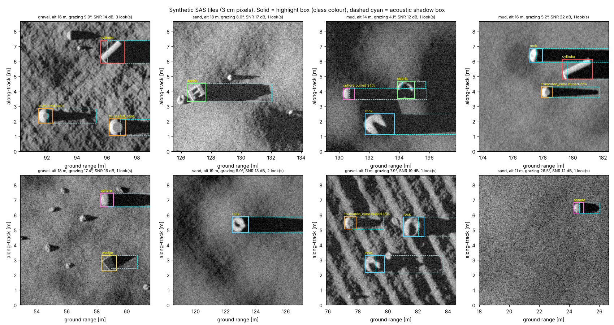</p>
<p align="center"><em>Random test tiles. Highlight boxes in class colour, shadow boxes dashed cyan. Note long shadows and saturated highlights at low grazing angles, partially buried objects, sand ripples, rock fields, ping drop-outs and multi-look vs single-look speckle.</em></p>

<p align="center">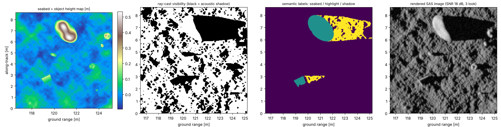</p>
<p align="center"><em>Renderer internals: height map → ray-cast visibility → semantic labels (seabed / highlight / shadow) → log-compressed SAS image.</em></p>

### Detector output, explanations and uncertainty

<p align="center">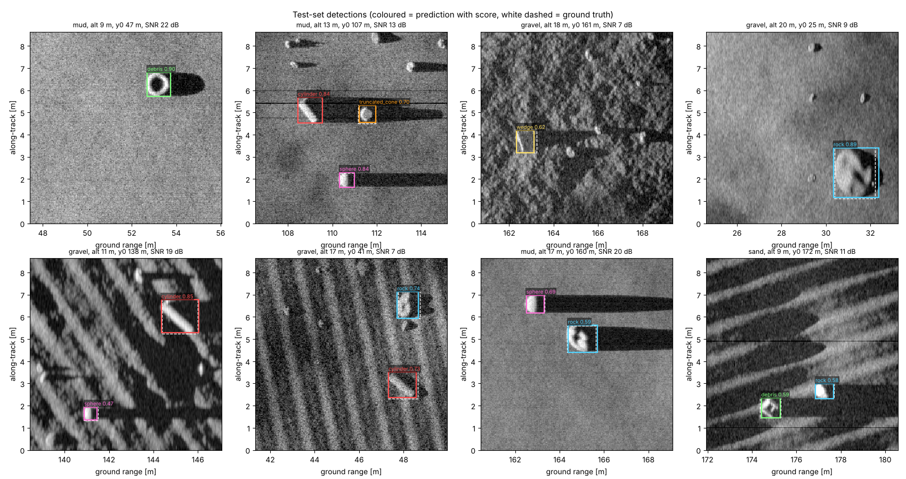</p>

<p align="center">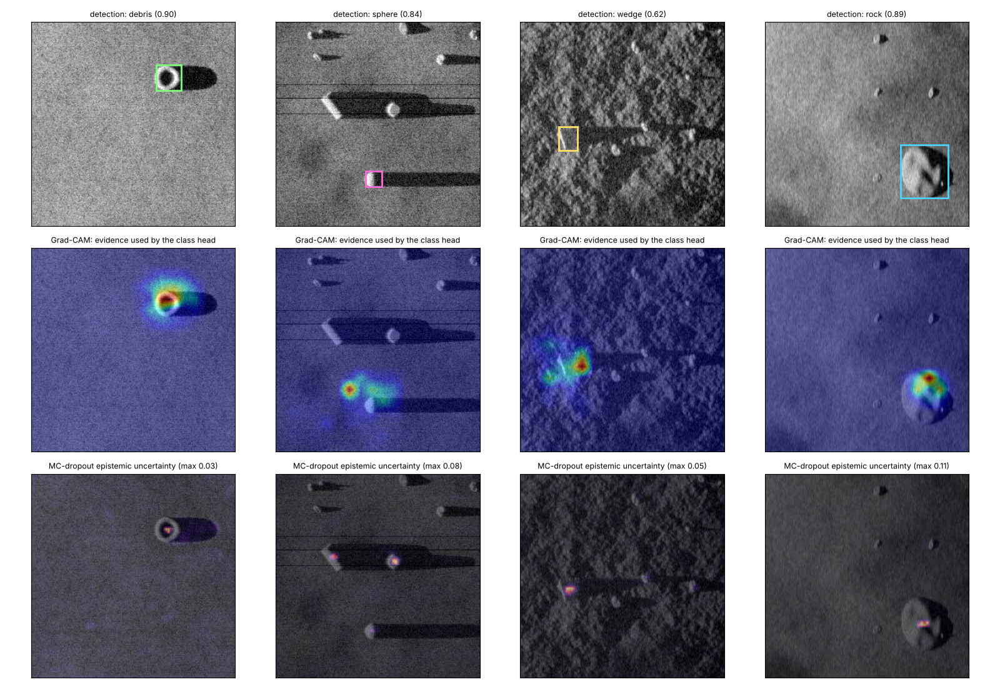</p>
<p align="center"><em>LayerCAM (a Grad-CAM variant for dense heads) shows the class head using the highlight <b>and</b> the shadow root; MC-dropout uncertainty concentrates on the object edges and ambiguous clutter.</em></p>

### Operating characteristics

<p align="center">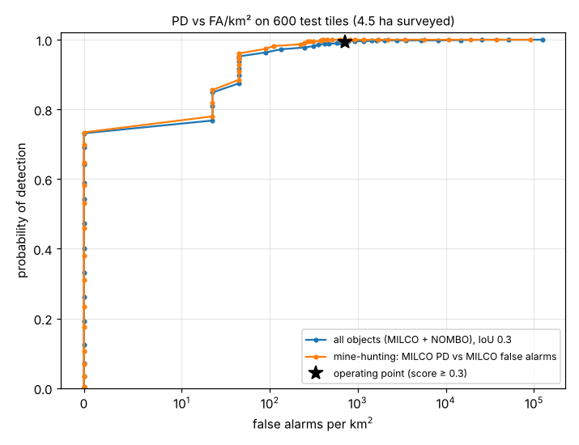 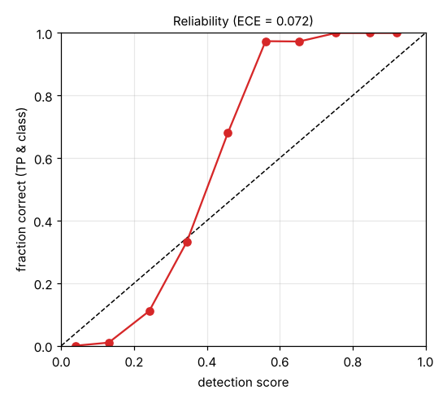</p>
<p align="center">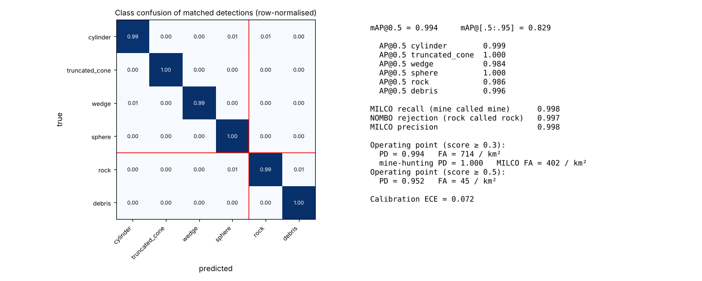</p>
<p align="center">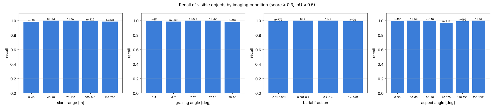</p>

### Label efficiency with self-supervision

<p align="center">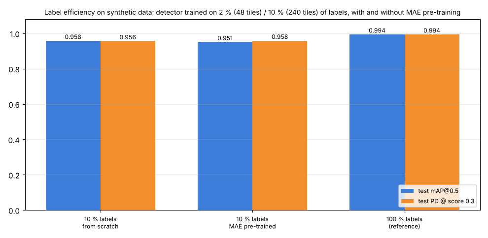</p>
<p align="center">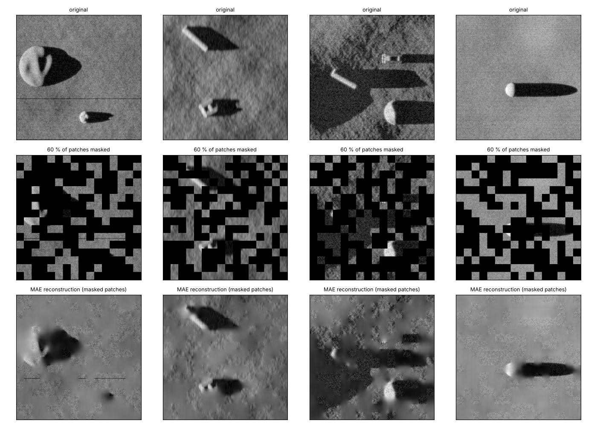</p>

### Streaming real-time ATR on a long swath

<p align="center">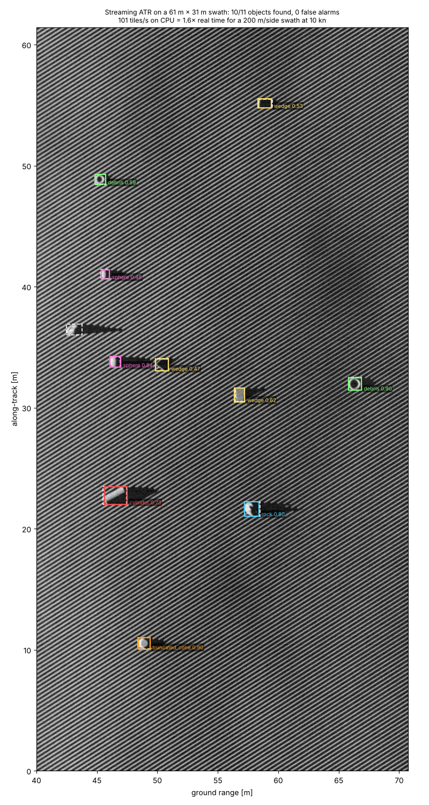</p>

### Where should the AUV look next?

<p align="center">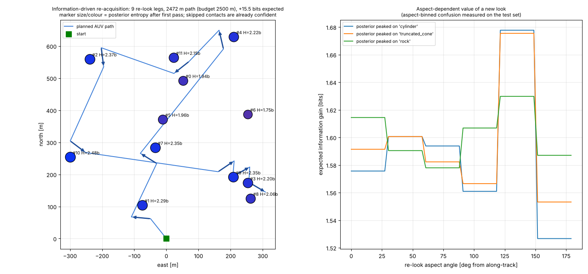</p>

### SAS resolution

<p align="center">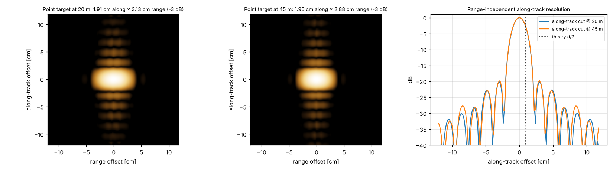</p>

Full numeric results: [`docs/RESULTS.md`](docs/RESULTS.md).

---

## Quick start

```bash
git clone https://github.com/shahriarrashid54/sub_sea_robotics.git && cd sub_sea_robotics
python -m pip install -e ".[dev]"          # CPU-only torch is fine: pip install torch --index-url https://download.pytorch.org/whl/cpu

sentinel info                               # default sonar: resolution, PRF, speed constraint
sentinel simulate --root data/sas_synth --n-train 2400 --n-val 300 --n-test 600   # ~10 min on 4 cores
sentinel train    --config configs/detector_base.yaml                             # ~1 h on 4 cores
sentinel evaluate --checkpoint runs/detector_base/best.pt --out-dir runs/detector_base/eval
sentinel export   --checkpoint runs/detector_base/best.pt --out runs/detector_base/model.onnx
sentinel stream   --onnx runs/detector_base/model.onnx --out-dir runs/stream      # real-time benchmark + GeoJSON contacts
sentinel pretrain --epochs 5 && sentinel train --config configs/detector_mae_10pct.yaml
sentinel plan     --metrics runs/detector_base/eval/metrics.json                  # re-acquisition planning demo

python scripts/demo_sas_processing.py       # full-physics echo simulation, back-projection, DPCA (~2 min)
python scripts/make_figures.py              # all figures in assets/
make test lint                              # 25 tests + ruff
```

`scripts/run_all.sh` chains everything (≈ 2.5 h on a 4-core CPU).

### Use it on real sonar data

Any COCO-format directory works; a YOLO → COCO converter and a sim-to-real recipe are in
[`docs/REAL_DATA.md`](docs/REAL_DATA.md).

---

## How it works

<details>
<summary><b>Scene & renderer</b> (<code>seabed_sentinel/sim/scene.py</code>, <code>renderer.py</code>)</summary>

* Terrain: multi-octave noise per sediment (mud / sand / gravel), metre-scale relief, asymmetric sand ripples.
* Objects as height functions: cylinder, truncated cone (Manta-like), wedge (Rockan-like), sphere = MILCO; rock, debris (crate / tyre) = NOMBO. Optional partial burial.
* Backscatter `I = μ cos²θᵢ + kₛ cosᵖθᵢ` with `cos θᵢ = n·ŝ` from the heightmap gradient and the SAS look direction (verified to reduce to `sin(grazing)` on a flat seabed).
* Shadows: a pixel is lit iff `(h−H)/y` exceeds the running maximum along range — exact, vectorised, attributes each shadow to the object casting it.
* Speckle: complex field `√I·CN(0,1) + noise`, convolved with a `sinc × sinc` PSF at 2× oversampling, `|·|²`, optional multi-look, block-averaged — correct single-look statistics and correlation length.
</details>

<details>
<summary><b>Full-physics tier</b> (<code>sim/acoustics.py</code>, <code>sim/sas_processor.py</code>)</summary>

* Phase centres at half the element offset; advancing `(N−k)·d/2` per ping leaves `k` redundant phase centres, fixing PRI and the maximum unambiguous range (98 m at 2 m/s).
* Echoes `Σₖ Aₖ w(θ) chirp(t−τₖ) e^{−j2πf_cτₖ}` accumulated per (ping, receiver) with `np.bincount`; Hann-tapered matched filter.
* Back-projection restricted to the real beam of each ping; `measure_resolution` reports −3 dB widths.
* DPCA: up-sampled cross-correlation of coincident phase-centre echoes + carrier-phase refinement → sway increments → trajectory → refocus.
</details>

<details>
<summary><b>Detector, training, evaluation</b> (<code>models/</code>, <code>train/</code>)</summary>

* Residual encoder (strides 4–32) + FPN to stride 4; shared 3×3 neck with `Dropout2d`; 1×1 heads for class heat-map (penalty-reduced focal loss), size, offset and 3-class segmentation.
* Trained on highlight boxes (= physical contact position) while the segmentation head forces shadow modelling.
* Metrics: VOC/COCO mAP, PD vs FA/km² (all objects and mine-hunting variants), MILCO/NOMBO confusion, breakdowns, aspect-binned confusion, ECE.
* `models/ssl.py`: convolutional MAE (60 % of 16-px patches masked) sharing the encoder; `--init-from runs/mae/encoder.pt`.
</details>

<details>
<summary><b>Deployment & autonomy</b> (<code>deploy/</code>, <code>autonomy/</code>)</summary>

* ONNX (opset 17, dynamic shapes) + parity check; NumPy decoder; `StreamingATR.push(strip)` → contacts with global coordinates; `benchmark_realtime` vs. sensor area rate.
* `geo.py`: pixel → ground range → ENU → lat/lon from per-ping navigation; GeoJSON contacts with size estimates.
* `aspect_fusion.py`: `P(pred | true, aspect-bin)`, Bayesian fusion, expected information gain. `reacquire.py`: greedy gain-per-metre leg selection under a budget, nearest-neighbour + 2-opt tour with turn penalties.
</details>

Design notes and derivations: [`docs/DESIGN.md`](docs/DESIGN.md).

---

## Repository layout

```
seabed_sentinel/
  sim/        scene.py  renderer.py  noise.py  acoustics.py  sas_processor.py  dataset_gen.py
  data/       coco.py  dataset.py
  models/     backbone.py  detector.py  losses.py  ssl.py
  train/      trainer.py  evaluate.py
  deploy/     export_onnx.py  stream.py  geo.py
  autonomy/   aspect_fusion.py  reacquire.py
  viz/        plots.py  gradcam.py
  cli.py
configs/      detector_base.yaml  detector_scratch_10pct.yaml  detector_mae_10pct.yaml
scripts/      demo_sas_processing.py  make_figures.py  write_results.py  run_all.sh
tests/        test_physics.py  test_data.py  test_model.py  test_deploy.py  test_autonomy.py
docs/         DESIGN.md  RESULTS.md  REAL_DATA.md  KRAKEN_RELEVANCE.md
```

## Limitations (stated plainly)

* All training and evaluation is on **synthetic** imagery; there is no public labelled SAS mine dataset. Absolute numbers will drop on real data — the sim-to-real recipe in `docs/REAL_DATA.md` is how I would close that gap.
* The acoustic model is point-scatterer based: no elastic target response, no multipath, no volume reverberation.
* DPCA estimates sway only (surge / yaw and INS fusion are natural extensions); the image-domain renderer assumes focused imagery apart from a smear artefact.

## References

* Hayes & Gough, *Synthetic Aperture Sonar: A Review of Current Status*, IEEE JOE 2009.
* Bellettini & Pinto, *Theoretical accuracy of synthetic aperture sonar micronavigation using a displaced phase-center antenna*, IEEE JOE 2002.
* Zhou et al., *Objects as Points* (CenterNet), 2019.
* He et al., *Masked Autoencoders Are Scalable Vision Learners*, CVPR 2022.
* Williams, *Underwater target classification in synthetic aperture sonar imagery using deep convolutional neural networks*, ICPR 2016.
* Kraken Robotics public materials on AquaPix MINSAS (337 kHz, 40 kHz LFM, 3 cm → 2 cm Ultra HD), KATFISH (3 × 3 cm at 200 m per side, live streaming), RTSAS and DPCA micronavigation — see `docs/KRAKEN_RELEVANCE.md`.

## Author

**Shahriar Rashid** — MSc Artificial Intelligence (Memorial University of Newfoundland), BEng (Hons, First Class) Robotics, Autonomous and Interactive Systems. St. John's, NL.

MIT License.
